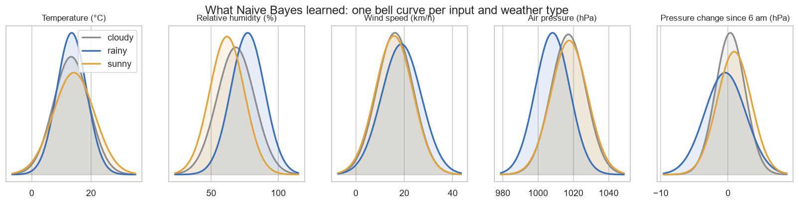

# Weather classifier

Classifies the weather at noon as sunny, cloudy or rainy from temperature, humidity and wind, with a Decision Tree and Naive Bayes, and tests them on three years they never saw. Built on 15 years of London weather from the Open-Meteo archive, with an interactive demo that explains each verdict.



## Results

Trained on 4,360 noon readings from 2010 to early 2022; tested on the 1,090 days from January 2022 to December 2024. 56% of days are cloudy, 22% rainy and 22% sunny.

| Model | Macro F1 | Accuracy | Sunny recall | Cloudy recall | Rainy recall |
| --- | --- | --- | --- | --- | --- |
| **Decision Tree** (depth 6) | 0.491 | 0.499 | 0.47 | 0.47 | 0.58 |
| **Naive Bayes** (equal priors) | 0.476 | 0.472 | 0.61 | 0.34 | 0.62 |
| Random Forest (benchmark) | 0.509 | 0.514 | 0.56 | 0.47 | 0.57 |
| Always cloudy (baseline) | 0.230 | 0.526 | 0 | 1 | 0 |

- **The air alone only half tells the weather.** Both models beat the baseline clearly on macro F1, and even the forest stays near 0.5. Clouds aren't visible in temperature, humidity and wind.
- **Rain is easiest**: humid air and low pressure. **Sunny and cloudy overlap most**, so most mistakes are between them.
- **Pressure helps.** With only the brief's three inputs, Naive Bayes falls from 0.48 to 0.40 macro F1 and the tree from 0.49 to 0.45. Humidity and pressure matter most; wind barely matters.
- **Accuracy misleads.** "Always cloudy" has the best accuracy and is useless. Macro F1 weighs the three types equally.

Full tables and figures: [docs/results.md](docs/results.md). How it was done: [docs/methodology.md](docs/methodology.md).

## Run it

Needs Python 3.14+ and [uv](https://docs.astral.sh/uv/).

```bash
uv sync
uv run python main.py
uv run streamlit run app.py
```

`main.py` downloads the data once into `data/`, then writes figures, tables and the tree's rules to `outputs/`, models to `models/` and the tables to `docs/results.md`. Outputs and models are committed, so the demo works without running it.

## The demo

- **Overview**: what the project is, how both models decide and what was found.
- **Classify**: set a noon reading or start from a real test day, and see each model's chances for the three types: the inputs that tipped Naive Bayes, or the questions the tree asked.
- **How it decides**: Naive Bayes's bell curves and every rule of the tree.
- **Results**: model comparison, the inputs comparison, mistakes, permutation importance and data checks.

## Layout

```
weather_classifier/   spec.py (inputs and models), data.py (download, weather codes to types),
                      explain.py (bell curves, per-reading evidence), report.py
pxlab/                shared engine (vendored): data checks, pipelines, tuning, evaluation, tree rules, app helpers
main.py               the full study
app.py                the Streamlit demo
docs/                 methodology, results, deploy
```

## Data

[Open-Meteo](https://open-meteo.com/) historical weather API (ERA5 reanalysis from the Copernicus Climate Change Service), CC BY 4.0. Hourly readings for central London, 2010 to 2024.

## License

MIT
