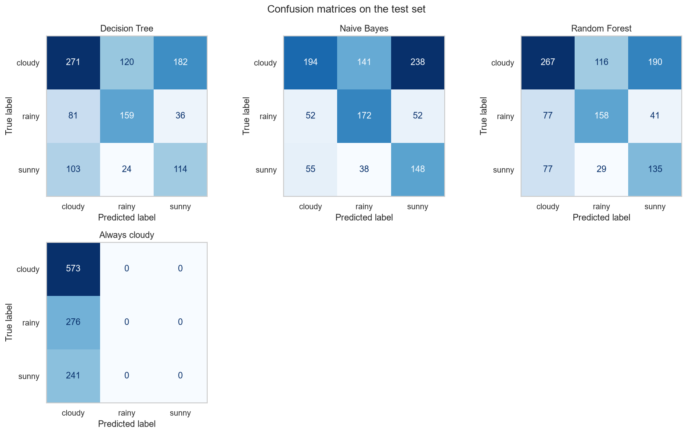
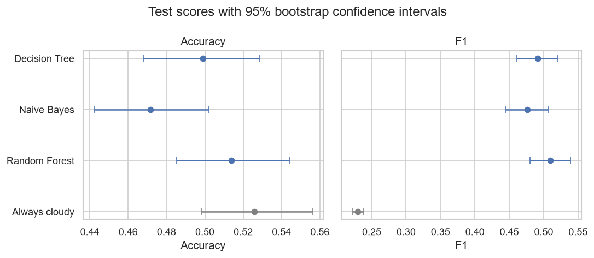
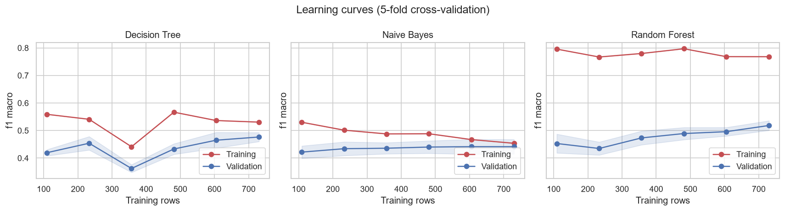
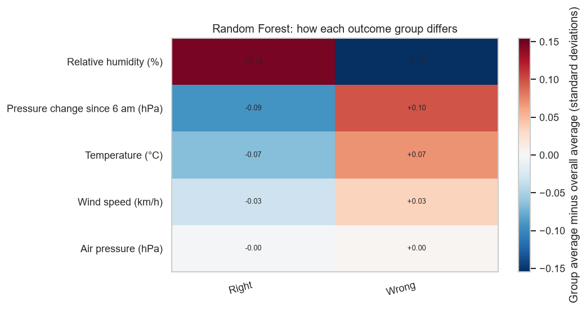
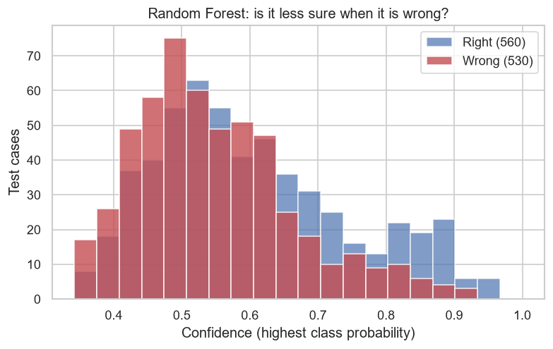
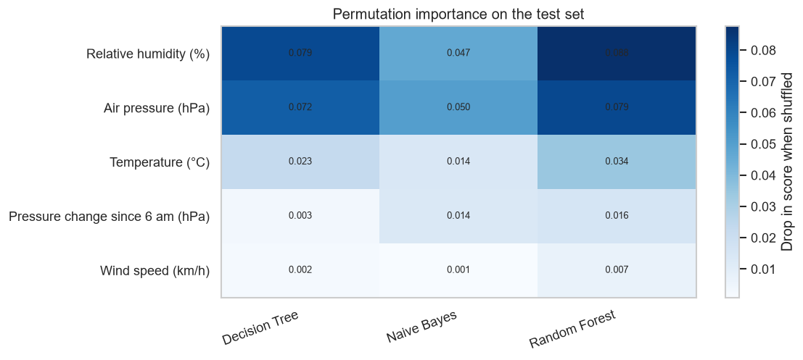
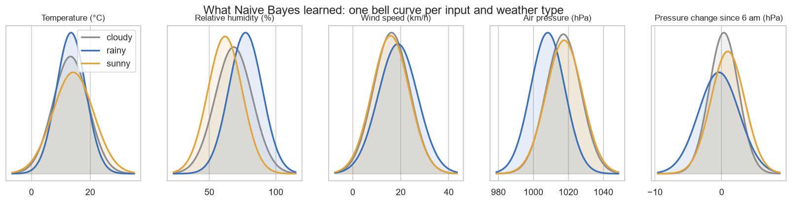
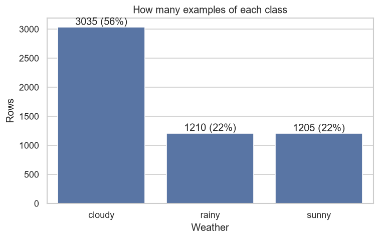
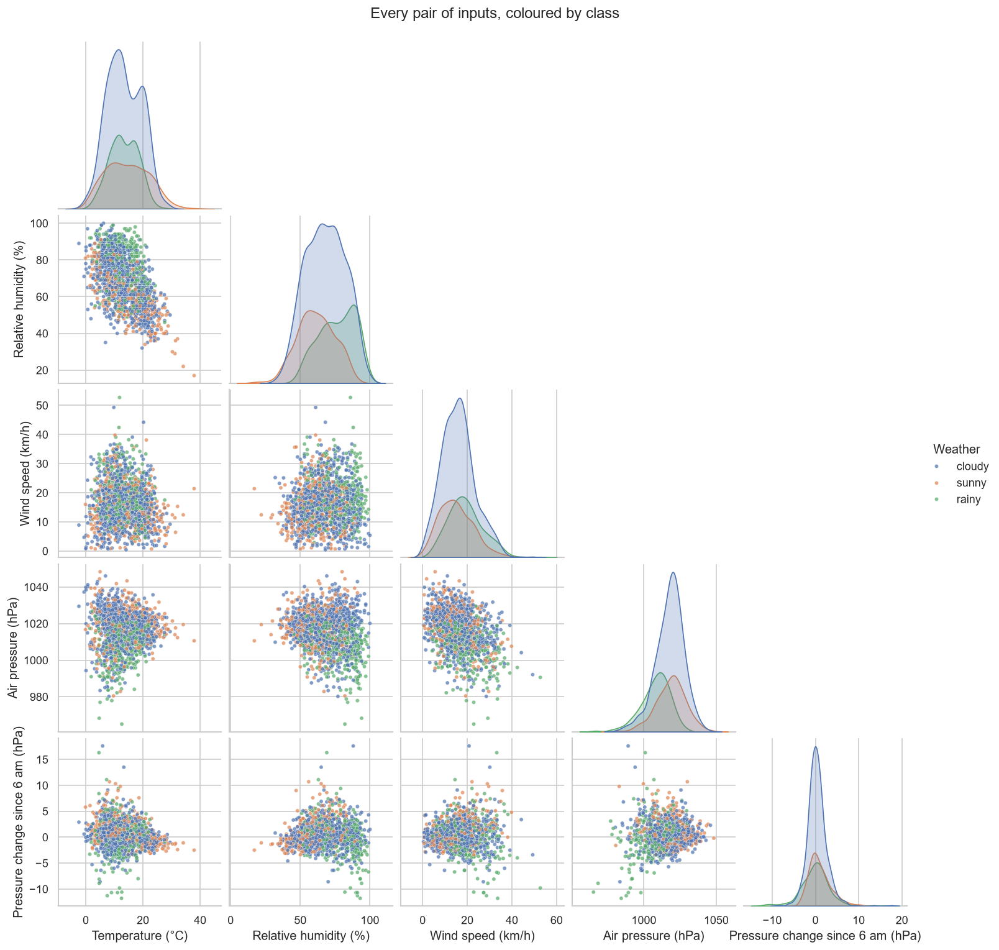
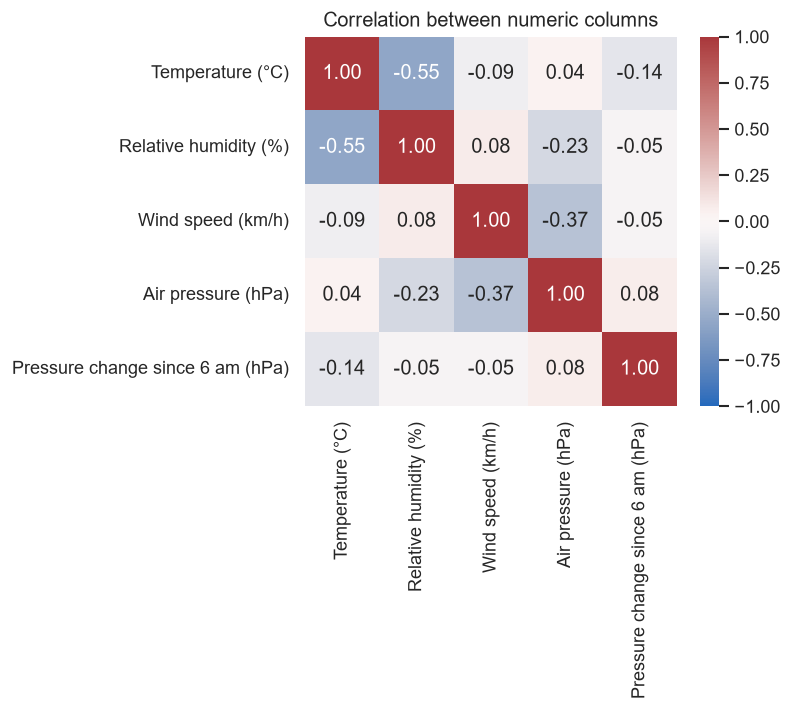

# Results

Produced by `python main.py`. The test set is the most recent fifth of the days (2022-01-06 to 2024-12-31); no test day was used for tuning or model choice. The full rules of the tree are in `outputs/weather/tree_rules.txt`.

## Models

### Scores on the unseen test days (macro averages over the three types)

| Model | Role | CV f1 macro | Accuracy | Precision | Recall | F1 |
| --- | --- | --- | --- | --- | --- | --- |
| Decision Tree | Main | 0.49 | 0.499 | 0.488 | 0.507 | 0.491 |
| Naive Bayes | Main | 0.458 | 0.472 | 0.491 | 0.525 | 0.476 |
| Random Forest | Benchmark beyond the course | 0.533 | 0.514 | 0.508 | 0.533 | 0.509 |
| Always cloudy | Baseline | 0.237 | 0.526 | 0.175 | 0.333 | 0.23 |

## Key findings

### What the in-depth analysis found

| Finding |
| --- |
| Random Forest scores F1 0.509 on the test set (95% interval 0.481 to 0.539); the baseline that ignores the inputs (Always cloudy) scores 0.230. |
| Random Forest against Decision Tree on right or wrong answers (McNemar): could be chance (p = 0.323). |
| Random Forest against Naive Bayes on right or wrong answers (McNemar): real difference (p = 0.011). |
| Random Forest against Always cloudy on right or wrong answers (McNemar): could be chance (p = 0.624). |
| Decision Tree overfits: training f1 macro 0.530 against validation 0.476; validation is still rising, so more data would likely help. |
| Naive Bayes generalises well: training and validation f1 macro are close (+0.012); validation has levelled off, so more data alone would help little. |
| Random Forest overfits: training f1 macro 0.768 against validation 0.518; validation is still rising, so more data would likely help. |
| The most common mix-up: cloudy predicted as sunny (190 cases, 33% of cloudy). |
| When Random Forest is at least 90% sure it is right 80% of the time (1% of test cases). |

## Reliability

Bootstrap 95% intervals: how much each test score could move with a different test sample.

### Confidence intervals

| Model | Score | Test value | Low | High |
| --- | --- | --- | --- | --- |
| Decision Tree | Accuracy | 0.4991 | 0.4679 | 0.5284 |
| Decision Tree | F1 | 0.4915 | 0.4611 | 0.521 |
| Naive Bayes | Accuracy | 0.4716 | 0.4422 | 0.5019 |
| Naive Bayes | F1 | 0.4762 | 0.444 | 0.5064 |
| Random Forest | Accuracy | 0.5138 | 0.4853 | 0.544 |
| Random Forest | F1 | 0.5093 | 0.4805 | 0.5389 |
| Always cloudy | Accuracy | 0.5257 | 0.4982 | 0.556 |
| Always cloudy | F1 | 0.2297 | 0.2217 | 0.2382 |

### Is the best model really better? (paired tests)

| Best model | Compared with | Best is better on | Other is better on | Test | p-value | Verdict |
| --- | --- | --- | --- | --- | --- | --- |
| Random Forest | Decision Tree | 123 | 107 | McNemar | 0.3226 | Could be chance |
| Random Forest | Naive Bayes | 182 | 136 | McNemar | 0.0115 | Real difference |
| Random Forest | Always cloudy | 293 | 306 | McNemar | 0.624 | Could be chance |

### Learning curves

| Model | Training rows | Training score | Validation score |
| --- | --- | --- | --- |
| Decision Tree | 109 | 0.5589 | 0.4193 |
| Decision Tree | 233 | 0.5408 | 0.4538 |
| Decision Tree | 357 | 0.4411 | 0.3621 |
| Decision Tree | 481 | 0.5666 | 0.4329 |
| Decision Tree | 605 | 0.5362 | 0.4648 |
| Decision Tree | 730 | 0.5305 | 0.4764 |
| Naive Bayes | 109 | 0.53 | 0.4216 |
| Naive Bayes | 233 | 0.5013 | 0.434 |
| Naive Bayes | 357 | 0.4877 | 0.4357 |
| Naive Bayes | 481 | 0.4883 | 0.4399 |
| Naive Bayes | 605 | 0.4672 | 0.4414 |
| Naive Bayes | 730 | 0.4536 | 0.4414 |
| Random Forest | 109 | 0.7955 | 0.4529 |
| Random Forest | 233 | 0.7669 | 0.4348 |
| Random Forest | 357 | 0.7797 | 0.4732 |
| Random Forest | 481 | 0.7969 | 0.489 |
| Random Forest | 605 | 0.7681 | 0.4957 |
| Random Forest | 730 | 0.7679 | 0.5182 |

## Error analysis

### Average inputs per outcome group

| Input | Right | Wrong |
| --- | --- | --- |
| Cases | 560.0 | 530.0 |
| Relative humidity (%) | 69.18 | 64.817 |
| Pressure change since 6 am (hPa) | -0.073 | 0.416 |
| Temperature (°C) | 14.243 | 15.085 |
| Wind speed (km/h) | 16.869 | 17.425 |
| Air pressure (hPa) | 1015.018 | 1015.097 |

### Classes the model mixes up

| Real class | Predicted as | Cases | Share of the real class |
| --- | --- | --- | --- |
| cloudy | sunny | 190 | 0.332 |
| cloudy | rainy | 116 | 0.202 |
| rainy | cloudy | 77 | 0.279 |
| sunny | cloudy | 77 | 0.32 |
| rainy | sunny | 41 | 0.149 |
| sunny | rainy | 29 | 0.12 |

### Accuracy by confidence

| Confidence | Cases | Share of the test set | Accuracy |
| --- | --- | --- | --- |
| 0% to 60% | 693 | 0.636 | 0.45 |
| 60% to 70% | 206 | 0.189 | 0.549 |
| 70% to 80% | 90 | 0.083 | 0.633 |
| 80% to 90% | 86 | 0.079 | 0.767 |
| 90% to 100% | 15 | 0.014 | 0.8 |

## Inputs

### The brief's three inputs against all five (test-set macro F1)

| Model | Temperature, humidity, wind | Plus pressure and its change |
| --- | --- | --- |
| Decision Tree | 0.452 | 0.491 |
| Naive Bayes | 0.399 | 0.476 |

### Permutation importance (drop in macro F1 when the input is shuffled)

|  | Decision Tree | Naive Bayes | Random Forest |
| --- | --- | --- | --- |
| Relative humidity (%) | 0.079 | 0.0465 | 0.0876 |
| Air pressure (hPa) | 0.0723 | 0.0503 | 0.0792 |
| Temperature (°C) | 0.0227 | 0.014 | 0.0344 |
| Pressure change since 6 am (hPa) | 0.0032 | 0.0136 | 0.0156 |
| Wind speed (km/h) | 0.0022 | 0.0009 | 0.0069 |

## Naive Bayes

## Mistakes

### Test days Naive Bayes got wrong

| temperature | humidity | wind_speed | pressure | pressure_change | Real | Predicted |
| --- | --- | --- | --- | --- | --- | --- |
| 4.7 | 74 | 28.8 | 1010.8 | 1.3 | sunny | rainy |
| 6.4 | 77 | 11.3 | 1003.2 | 2.6 | sunny | rainy |
| 7.0 | 89 | 11.0 | 1019.6 | 5.0 | cloudy | rainy |
| 2.6 | 81 | 2.3 | 1036.5 | -0.9 | sunny | cloudy |
| 4.7 | 92 | 9.0 | 1026.2 | -1.5 | sunny | cloudy |
| 5.7 | 82 | 4.7 | 1038.9 | 3.1 | sunny | cloudy |
| 4.2 | 76 | 10.5 | 1039.7 | 0.0 | sunny | cloudy |
| 4.9 | 84 | 9.7 | 1037.9 | 0.1 | sunny | cloudy |
| 12.5 | 77 | 35.5 | 1026.2 | -1.1 | cloudy | rainy |
| 8.9 | 80 | 16.2 | 1014.2 | -1.2 | cloudy | rainy |
| 5.6 | 77 | 21.9 | 1010.6 | 3.6 | sunny | rainy |
| 10.6 | 66 | 31.0 | 1005.1 | -0.4 | cloudy | rainy |
| 6.8 | 71 | 4.6 | 1034.1 | 3.3 | cloudy | sunny |
| 8.0 | 82 | 31.3 | 1001.2 | -7.0 | cloudy | rainy |
| 14.5 | 76 | 33.5 | 996.9 | 0.9 | cloudy | rainy |
| 9.7 | 59 | 68.0 | 986.4 | -7.5 | sunny | rainy |
| 10.3 | 65 | 38.2 | 1007.5 | 4.9 | cloudy | rainy |
| 13.6 | 64 | 38.3 | 1014.4 | -3.1 | cloudy | rainy |
| 10.5 | 59 | 31.4 | 1021.9 | -2.8 | rainy | cloudy |
| 9.4 | 58 | 18.6 | 1027.0 | 5.7 | cloudy | sunny |

## Data

### Data quality

| Column | Type | Missing | Distinct values |
| --- | --- | --- | --- |
| temperature | numeric | 0 | 323 |
| humidity | numeric | 0 | 75 |
| wind_speed | numeric | 0 | 405 |
| pressure | numeric | 0 | 582 |
| pressure_change | numeric | 0 | 199 |
| condition | target | 0 | 3 |

